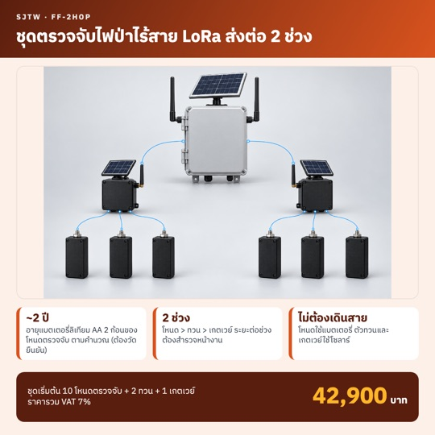
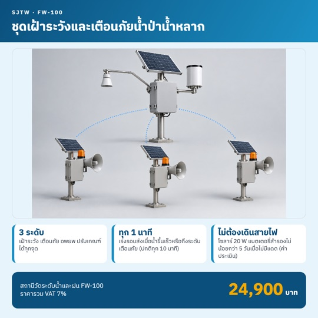
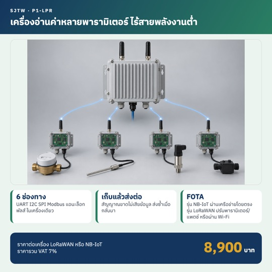
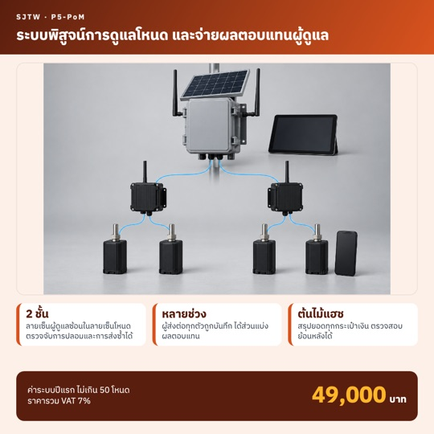
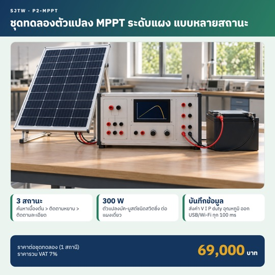
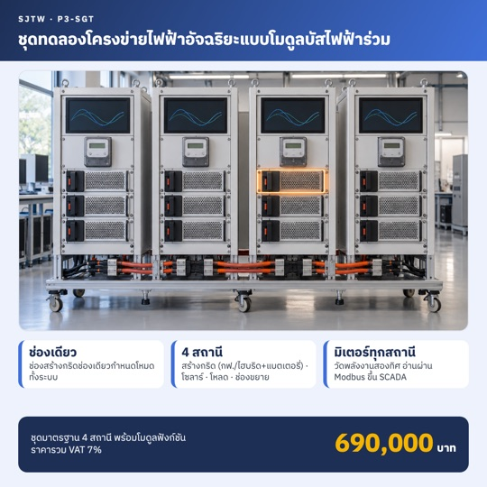
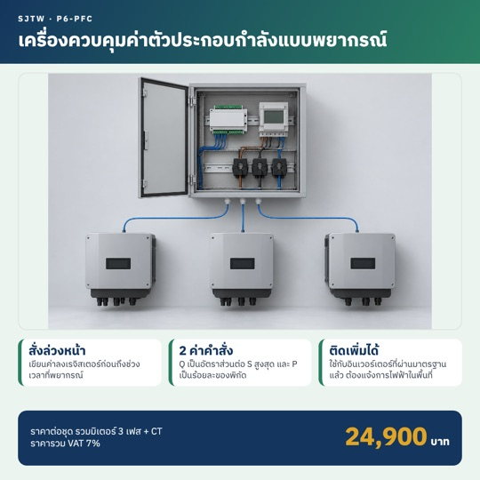
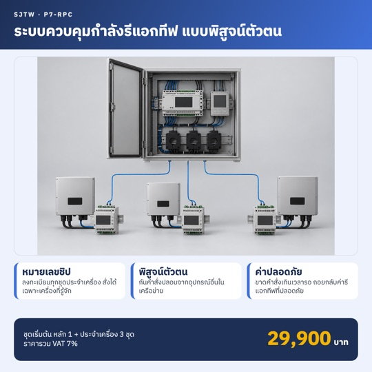
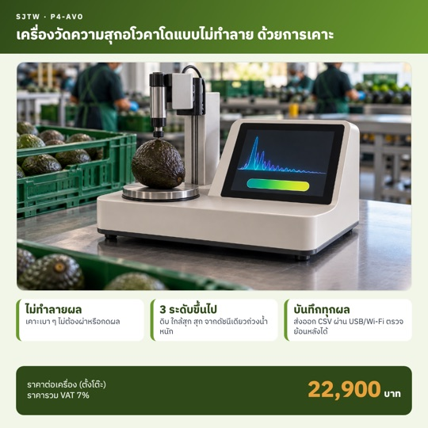

<h3 align="center">ระบบ IoT พลังงานต่ำ เครือข่าย LoRa และข้อมูลที่ตรวจสอบได้ด้วยบล็อกเชน 
สำหรับงานเฝ้าระวังภัยพิบัติ พลังงาน และการเกษตร</h3>

Low-power IoT, LoRa networks and verifiable data for disaster monitoring, energy and agriculture

---

## ผลงานเด่น: FireWild ระบบเฝ้าระวังไฟป่า

ระบบครบวงจรตั้งแต่จุดตรวจในป่าถึงหน้าเว็บ ทุกข้อมูลลงลายเซ็นจากตัวอุปกรณ์ และบันทึกหลักฐานรายวันบนบล็อกเชน Polygon ชุมชนมีส่วนร่วมดูแลอุปกรณ์ผ่านแอปบนโทรศัพท์ ทดสอบนำร่องที่ ต.เชิงดอย อ.ดอยสะเก็ด จ.เชียงใหม่

<table>
<tr>
<td width="50%" valign="top">

- จุดตรวจ nRF52840 ส่งต่อหลายทอดทาง LoRa
- เกตเวย์โซลาร์ 4G กินไฟเฉลี่ยราว 0.45 W
- เตือนเหตุไฟถึงผู้รับทาง Telegram ภายในราว 1 นาที
- อัปเดตเฟิร์มแวร์จากระยะไกลแบบลงลายเซ็น ถอยกลับเองได้
- เข้าสู่ระบบด้วย passkey ไม่ใช้รหัสผ่าน
- ข้อมูลเปิดรายพื้นที่ ดาวน์โหลด CSV และ API

**[ดูระบบที่ทำงานจริง](https://firewild-gw.lawan.dev/o/chengdoi)**

</td>
<td width="50%"></td>
</tr>
</table>

## สินค้าและชุดอุปกรณ์

<table>
<tr>
<td></td>
<td></td>
<td></td>
</tr>
<tr>
<td></td>
<td></td>
<td></td>
</tr>
<tr>
<td></td>
<td></td>
<td></td>
</tr>
</table>

| รหัส | สินค้า |
| --- | --- |
| FF-2HOP | ชุดตรวจจับไฟป่าไร้สาย LoRa ส่งต่อ 2 ช่วง |
| FW-100 | ชุดเฝ้าระวังและเตือนภัยน้ำป่าน้ำหลาก |
| P1-LPR | เครื่องอ่านค่าหลายพารามิเตอร์ไร้สายพลังงานต่ำ LoRaWAN / NB-IoT |
| P5-PoM | ระบบพิสูจน์การดูแลโหนดและจ่ายผลตอบแทนผู้ดูแล |
| P2-MPPT | ชุดทดลองตัวแปลง MPPT ระดับแผง แบบหลายสถานะ |
| P3-SGT | ชุดทดลองโครงข่ายไฟฟ้าอัจฉริยะแบบโมดูลบัสไฟฟ้าร่วม |
| P6-PFC | เครื่องควบคุมค่าตัวประกอบกำลังแบบพยากรณ์ สำหรับอินเวอร์เตอร์ |
| P7-RPC | ระบบควบคุมกำลังรีแอกทีฟแบบพิสูจน์ตัวตน |
| P4-AVO | เครื่องวัดความสุกอโวคาโดแบบไม่ทำลาย ด้วยการเคาะ |

ราคาในภาพรวมภาษีมูลค่าเพิ่ม 7% แล้ว

## บริการ

- ออกแบบและผลิตฮาร์ดแวร์ IoT พลังงานต่ำ ตั้งแต่ผังวงจรถึงต้นแบบพร้อมใช้งาน
- เครือข่าย LoRa / LoRaWAN / NB-IoT / 4G สำหรับพื้นที่ห่างไกล
- เซิร์ฟเวอร์ แดชบอร์ด แอปมือถือ และบริการข้อมูล DaaS
- ข้อมูลที่ตรวจสอบย้อนหลังได้ด้วยบล็อกเชน
- ชุดฝึกและชุดทดลองด้านพลังงานไฟฟ้าสำหรับสถานศึกษา

## เทคโนโลยี

## ติดต่อ

สนใจใบเสนอราคา พื้นที่นำร่อง หรือการพัฒนาระบบเฉพาะงาน [เปิดเรื่องใหม่ที่นี่](https://github.com/sjtwservice2017/sjtwservice2017/issues/new) แล้วบริษัทจะติดต่อกลับ

SJTW Service Company Limited · บริษัท เอส เจ ที ดับบลิว เซอร์วิส จำกัด

