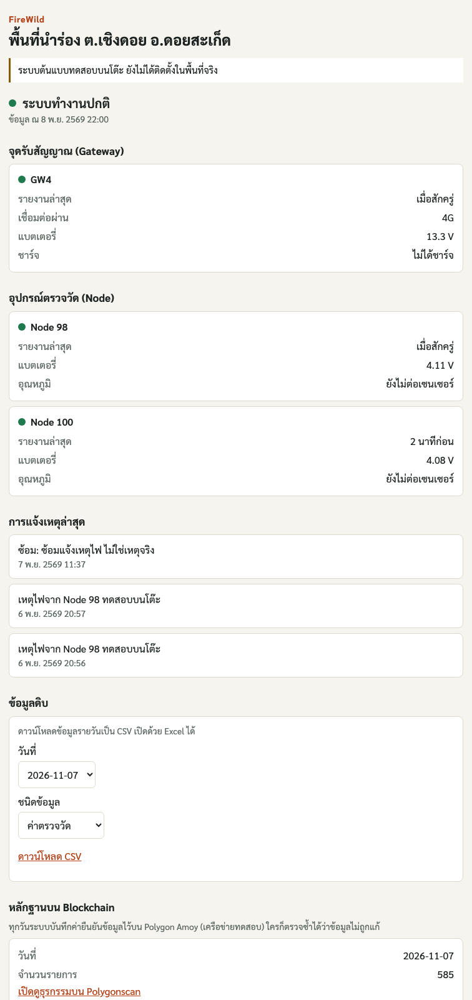
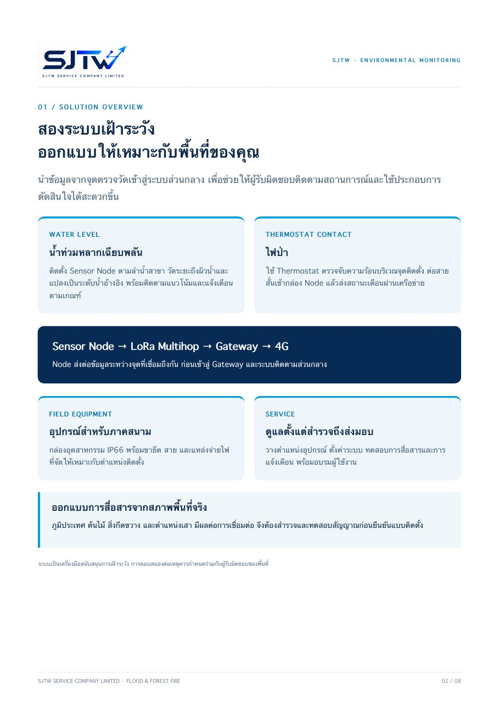
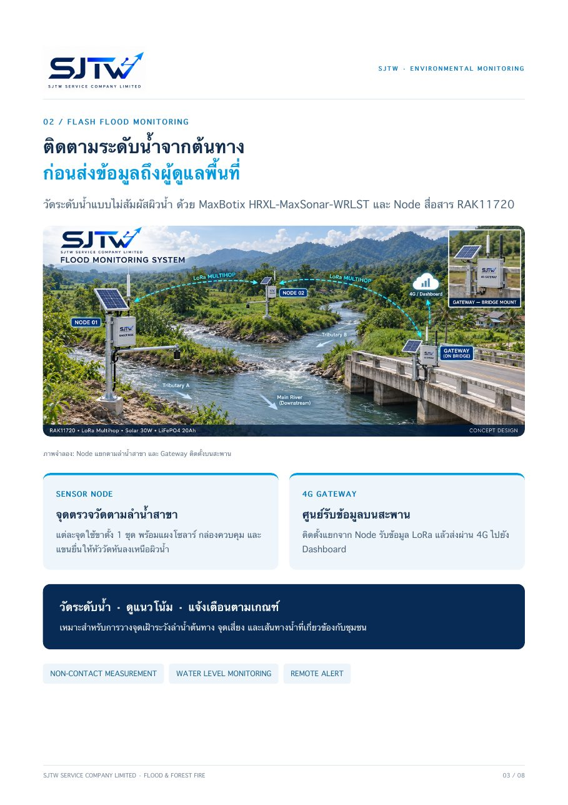
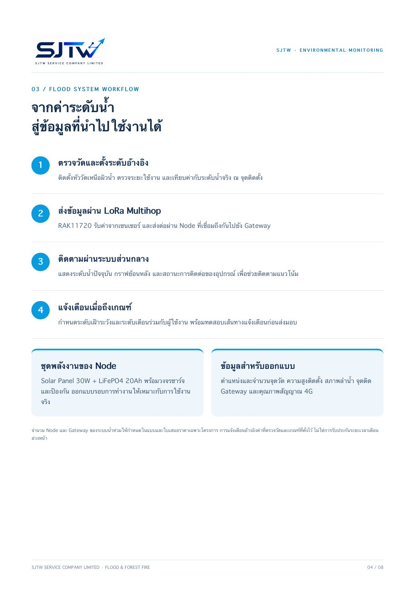
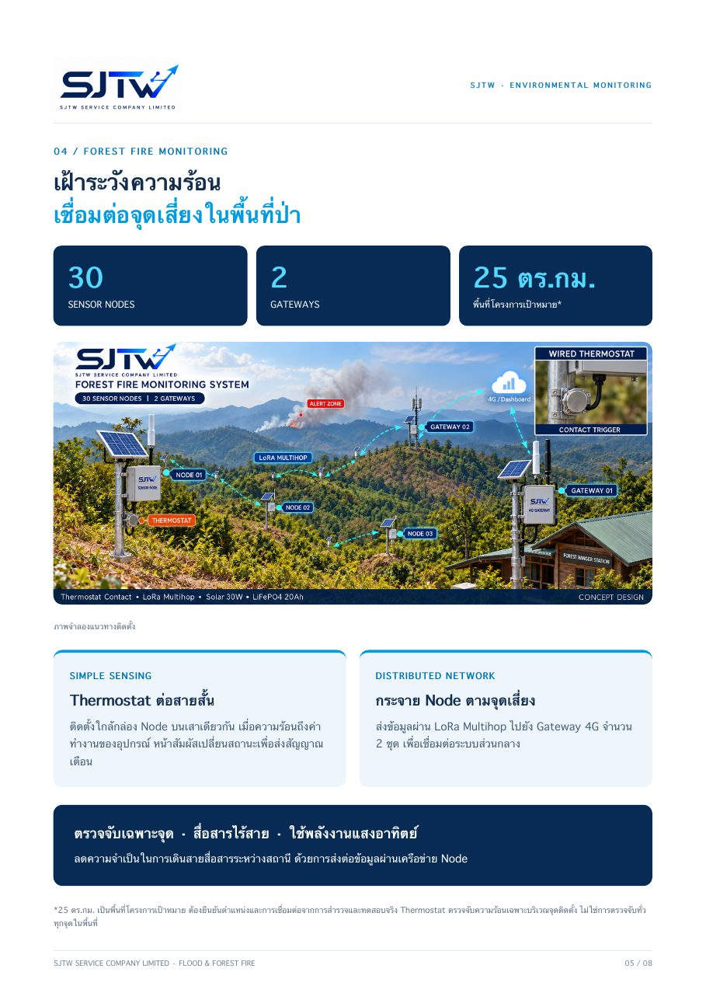
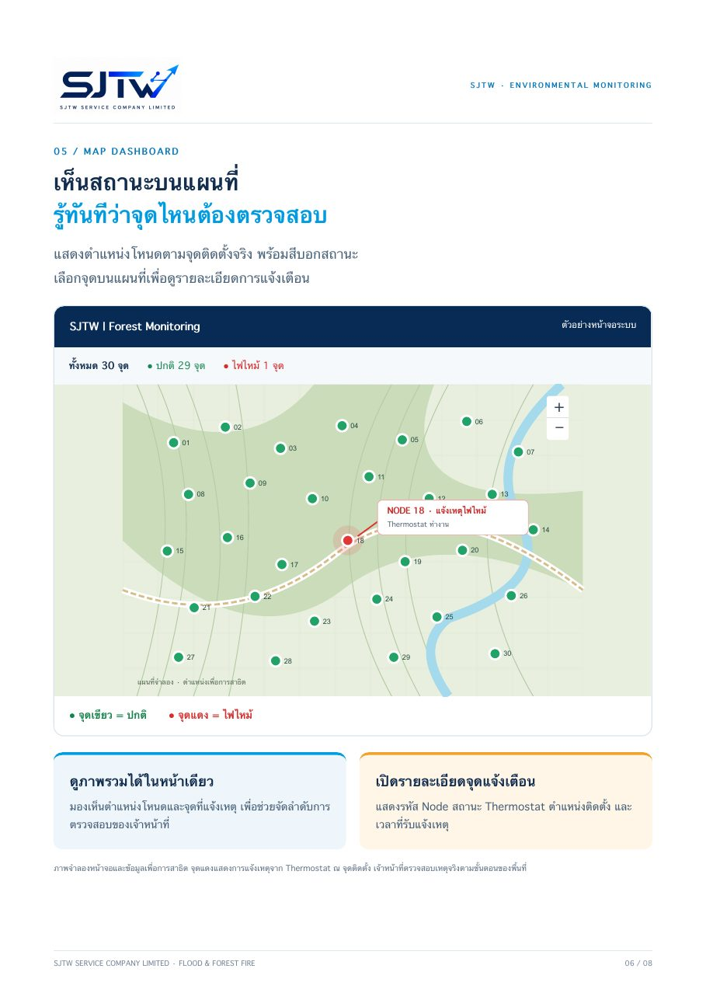
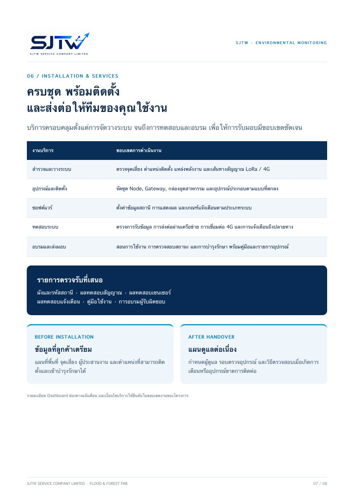
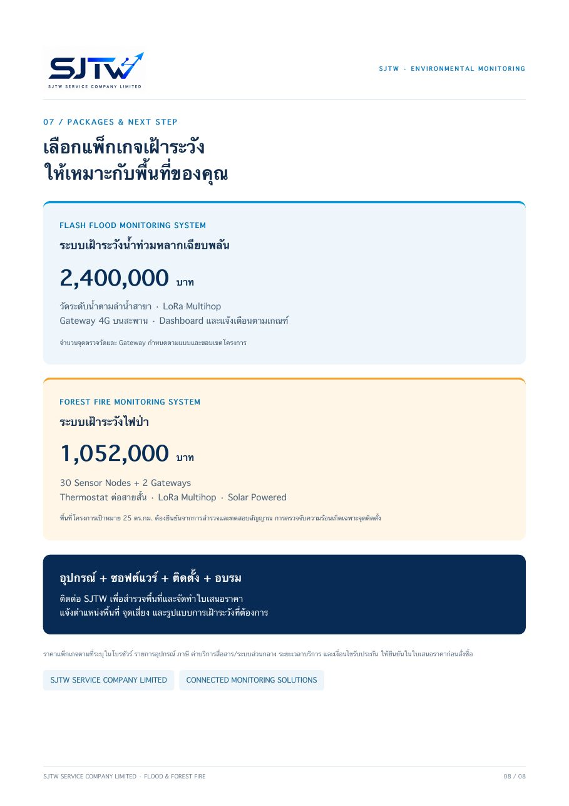

<h3 align="center">ระบบ IoT พลังงานต่ำ เครือข่าย LoRa และข้อมูลที่ตรวจสอบได้ด้วยบล็อกเชน 
สำหรับงานเฝ้าระวังภัยพิบัติ</h3>

Low-power IoT, LoRa networks and verifiable data for disaster monitoring

---

## ผลงานเด่น: FireWild ระบบเฝ้าระวังไฟป่า

ระบบครบวงจรตั้งแต่จุดตรวจในป่าถึงหน้าเว็บ ทุกข้อมูลลงลายเซ็นจากตัวอุปกรณ์ และบันทึกหลักฐานรายวันบนบล็อกเชน Polygon ชุมชนมีส่วนร่วมดูแลอุปกรณ์ผ่านแอปบนโทรศัพท์ ทดสอบนำร่องที่ ต.เชิงดอย อ.ดอยสะเก็ด จ.เชียงใหม่

<table>
<tr>
<td width="50%" valign="top">

- จุดตรวจ nRF52840 ส่งต่อหลายทอดทาง LoRa
- เกตเวย์โซลาร์ 4G กินไฟเฉลี่ยราว 0.45 W
- เตือนเหตุไฟถึงผู้รับทาง Telegram ภายในราว 1 นาที
- อัปเดตเฟิร์มแวร์จากระยะไกลแบบลงลายเซ็น ถอยกลับเองได้
- เข้าสู่ระบบด้วย passkey ไม่ใช้รหัสผ่าน
- ข้อมูลเปิดรายพื้นที่ ดาวน์โหลด CSV และ API

</td>
<td width="50%"></td>
</tr>
</table>

## ระบบเฝ้าระวังน้ำท่วมและไฟป่า

เชื่อมข้อมูลจากพื้นที่เสี่ยง ด้วยเครือข่าย LoRa Multihop พร้อม Gateway 4G ซอฟต์แวร์ ติดตั้ง และอบรม

<table>
<tr><td width="50%"></td><td width="50%"></td></tr>
<tr><td></td><td></td></tr>
<tr><td></td><td></td></tr>
<tr><td></td><td></td></tr>
</table>

<a href="brochure/SJTW-flood-and-fire-brochure.pdf"><b>ดาวน์โหลดโบรชัวร์ PDF</b></a>

## บริการ

- ออกแบบและผลิตฮาร์ดแวร์ IoT พลังงานต่ำ ตั้งแต่ผังวงจรถึงต้นแบบพร้อมใช้งาน
- เครือข่าย LoRa / LoRaWAN / NB-IoT / 4G สำหรับพื้นที่ห่างไกล
- เซิร์ฟเวอร์ แดชบอร์ด แอปมือถือ และบริการข้อมูล DaaS
- ข้อมูลที่ตรวจสอบย้อนหลังได้ด้วยบล็อกเชน

## เทคโนโลยี

## ติดต่อ

สนใจใบเสนอราคา พื้นที่นำร่อง หรือการพัฒนาระบบเฉพาะงาน [เปิดเรื่องใหม่ที่นี่](https://github.com/sjtwservice2017/sjtwservice2017/issues/new) แล้วบริษัทจะติดต่อกลับ

SJTW Service Company Limited · บริษัท เอส เจ ที ดับบลิว เซอร์วิส จำกัด

